# Surfaces UI

**React components for data and analytics that people and agents build with together.**

Tables that stay fast at any size, charts that follow Tufte and Few, pivots, SQL editing, catalog and data-model browsing, pipelines, and chat. An agent can describe any of them as JSON, and a person can keep changing what it drew. The same components work in your app, a chat reply, a side panel and an MCP frame.

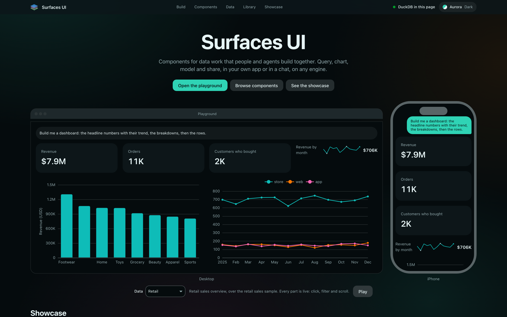

**[Try it in your browser](https://upgraded-bassoon-nkkgz3m.pages.github.io/)**: the playground with DuckDB running in the page over six sample models. Nothing to install, and nothing leaves the browser. The guides and recipes are there too, under **[Docs](https://upgraded-bassoon-nkkgz3m.pages.github.io/#docs)**.

### Watch: four short walkthroughs

**1. [What it is and where it goes](docs/media/1-introduction.mp4)** (1:55). Why the library exists, a dashboard made of its components, the catalog that defines each one once, and one saved page drawn as an app page, a chat reply, a side panel and an MCP frame.

https://github.com/user-attachments/assets/099018d8-249d-47bf-b8c8-6e9c5cd79879

**2. [Pages from configuration](docs/media/2-pages-from-configuration.mp4)** (2:42). A page written as JSON by hand in the playground: a metric, a layout, filters kept in the page's data, the catalog refusing a misspelled prop, json-render and A2UI, then the same components as replies in a chat, with an approval before anything changes.

https://github.com/user-attachments/assets/e308fdc2-f3c2-4dc2-a03a-49f49bb02a10

**3. [From a raw source to a dashboard](docs/media/3-raw-source-to-dashboard.mp4)** (4:07). One conversation, start to finish: connect the files, clean them and review personal data, run the pipeline, agree a semantic model on the join diagram, build a report and keep a dashboard. Every reply is made of the library's components reading real data, and a person approves each step.

https://github.com/user-attachments/assets/2d6e8ea0-0fff-4300-828b-556ab68cb5c5

**4. [One design, every screen](docs/media/4-one-design-every-screen.mp4)** (1:33). Close up on the numbers and chart lines, one live dashboard on a desktop, an iPad and an iPhone, a screen narrowed from desktop to phone width as the page reflows, and the eight themes in dark and light.

https://github.com/user-attachments/assets/dd7e2b23-ead0-4925-843d-7e4a1ea63e27

Open **Sample analysis** in the playground (`pnpm dev`) to play the third one yourself.

<p align="center">
  <a href="#try-it-in-five-minutes">Try it</a> ·
  <a href="docs/getting-started.md">Getting started</a> ·
  <a href="docs/agent-integration.md">Agent integration</a> ·
  <a href="docs/recipes/README.md">Recipes</a> ·
  <a href="docs/catalog/components">Component reference</a> ·
  <a href="llms.txt">llms.txt</a>
</p>

## Why it exists

Most data UIs load the rows into the browser and sort them there. That breaks at a million rows, and it breaks again when an agent starts writing the UI. Surfaces UI is built on three ideas:

- **The database does the work.** Every sort, filter, page, group and aggregate is sent to the engine as SQL. A grid over a billion-row table fetches only the rows in view, and a chart asks for the summary rather than the rows.
- **Agents draw with the same parts people use.** A dashboard, chat reply or form is a JSON document checked against one catalog of 56 components. Anything the catalog does not allow is shown as a notice and never drawn.
- **A person stays in charge.** Every control a person can set, an agent can set too, and the agent sees what the person changed. Anything that changes data pauses for an approval that the backend checks again.

## What's in it

### Chat that draws live components

Replies hold Markdown, tool steps and any catalog component, all querying real data. Anything that changes data stops for an approval: the person sees the exact SQL, gives a reason, and can edit it before allowing it.

| | |
|---|---|
| 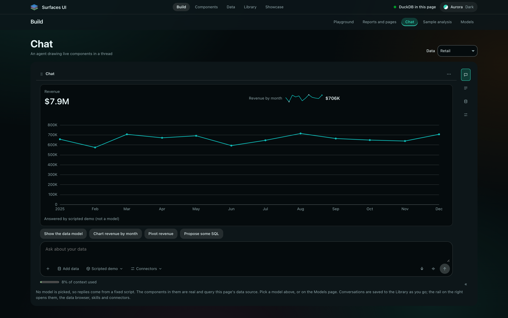 | 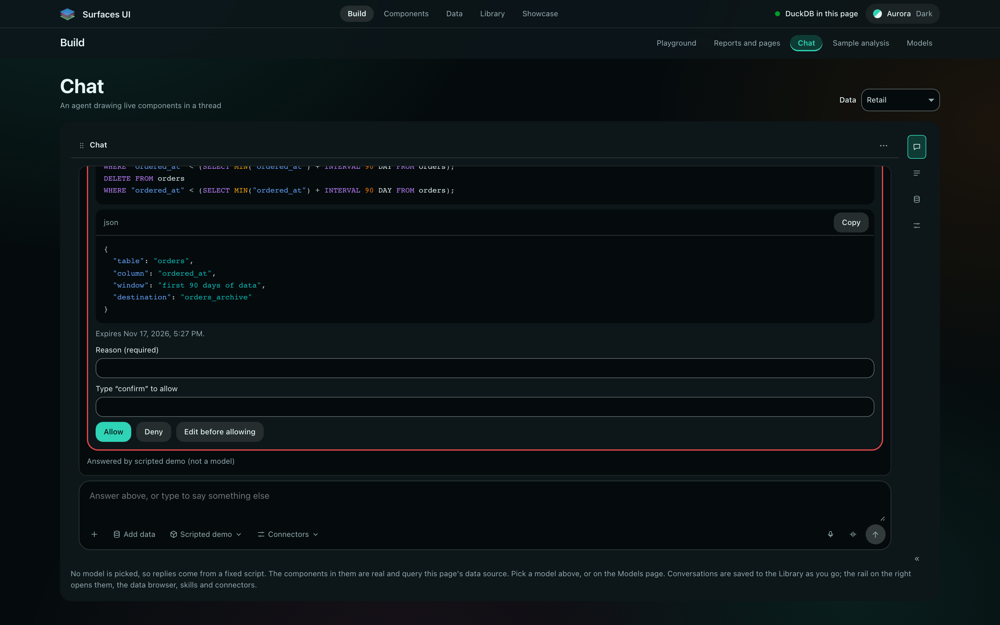 |

### Pages and the composer

A page is a plain JSON document. Change it with plain-language instructions, where each one is a single undo step. Or build it in the playground, with an agent beside the surface and the A2UI messages a panel away.

| | |
|---|---|
| 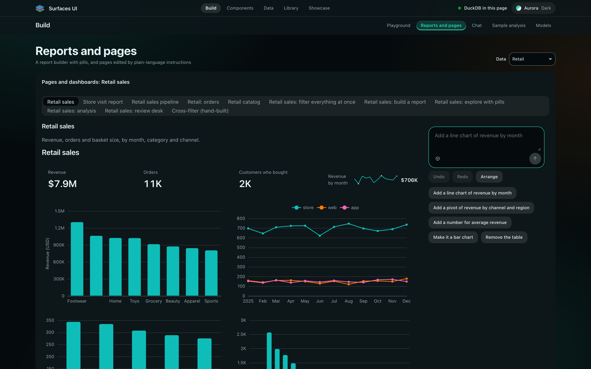 **Pages**: plain-language instructions, each one undo step, and arranging by hand. | 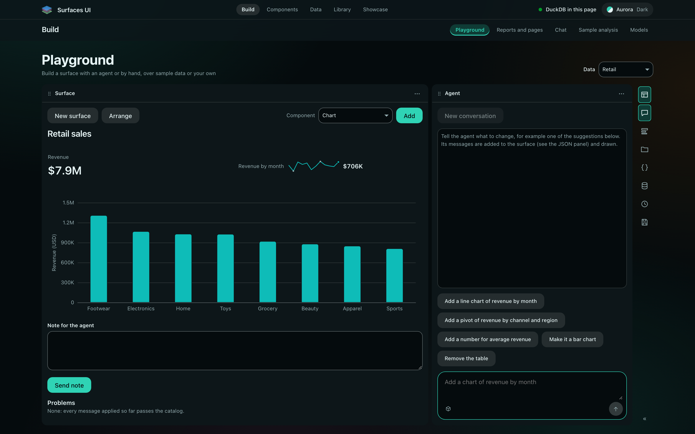 **Playground**: an agent beside the surface, or add and arrange components yourself. |

### The data, end to end

| | |
|---|---|
| 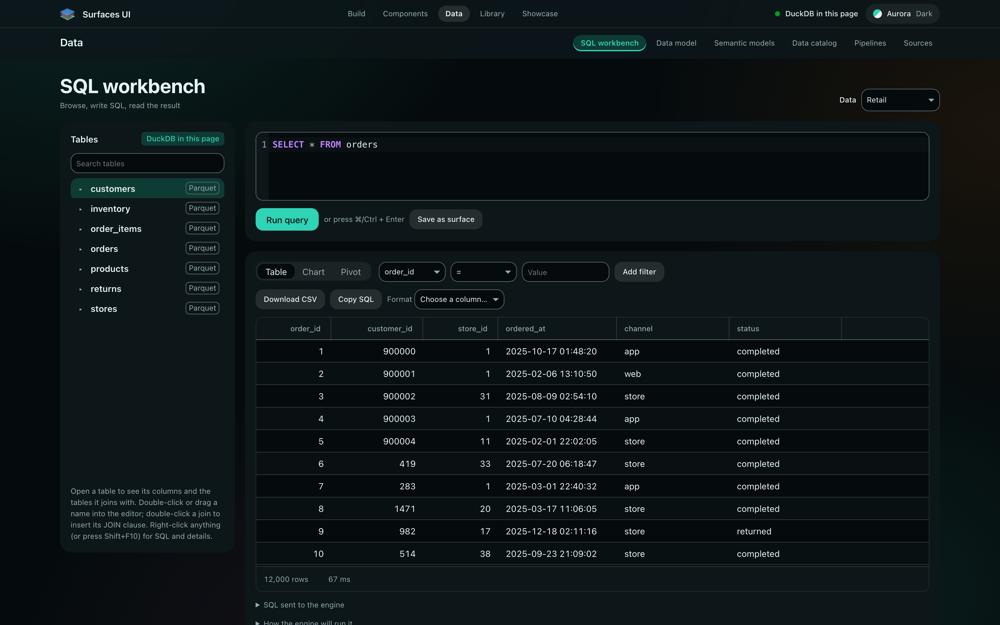 **SQL workbench**: browse, write SQL, and get results as a table, chart or pivot. Includes CSV export and the query plan. | 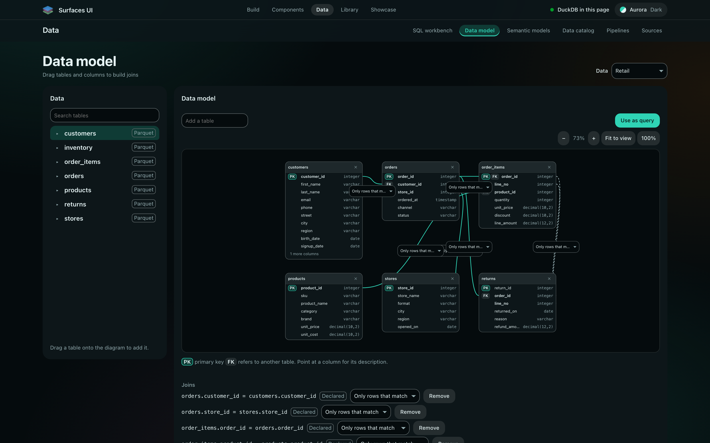 **Data model**: drag tables and columns to join them. Declared keys and inferred guesses are labelled differently. |
| 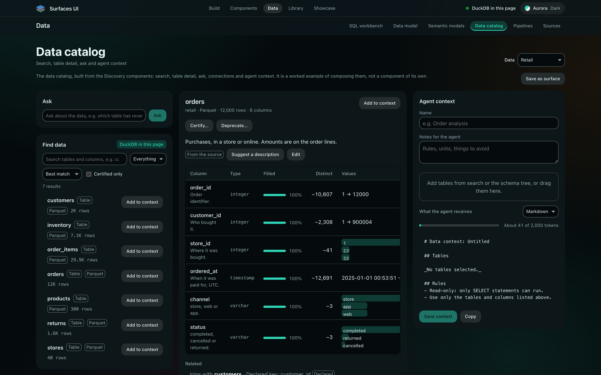 **Data catalog**: search by words or meaning, profile columns, certify tables, and build the context an agent receives. | 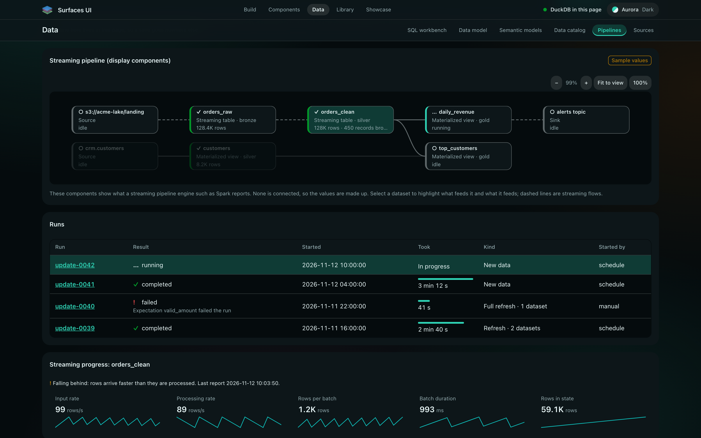 **Pipelines**: datasets built from one another, with quality rules. Each is run, checked and refreshed on the server. |

### Crisp on every screen

The same page is drawn on a desktop, a tablet and a phone with no separate mobile build. Components answer to the width of the box they are in, not the window, so a chart in a side panel lays itself out as it would on a phone. Text, numbers and chart lines are drawn at the screen's full pixel density, figures sit in even columns, and every colour comes from the theme.

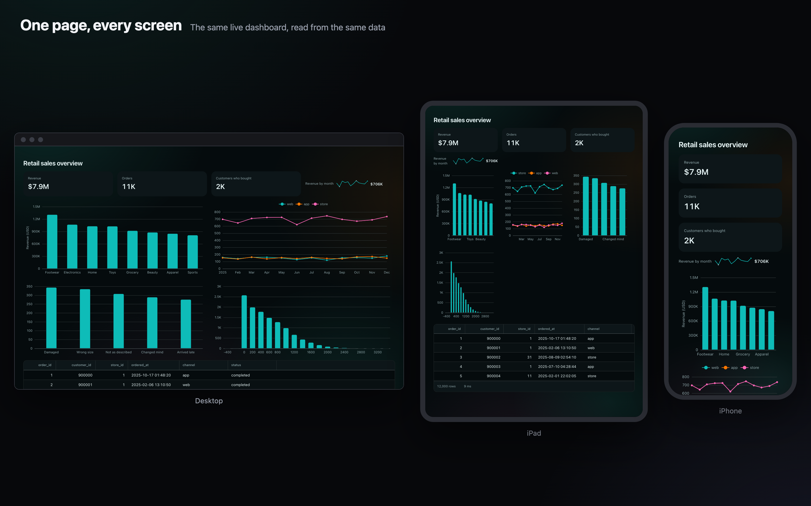

| | |
|---|---|
| 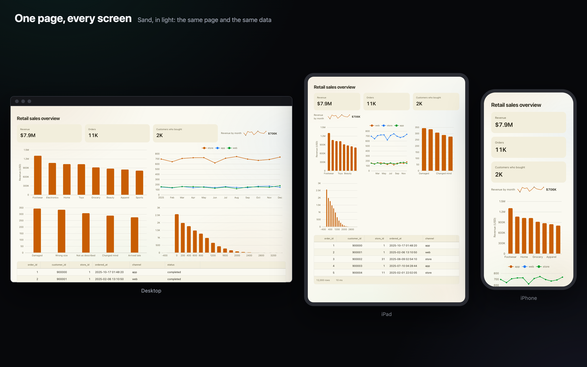 **Light or dark, in any theme**: the same three screens in Sand, light. | 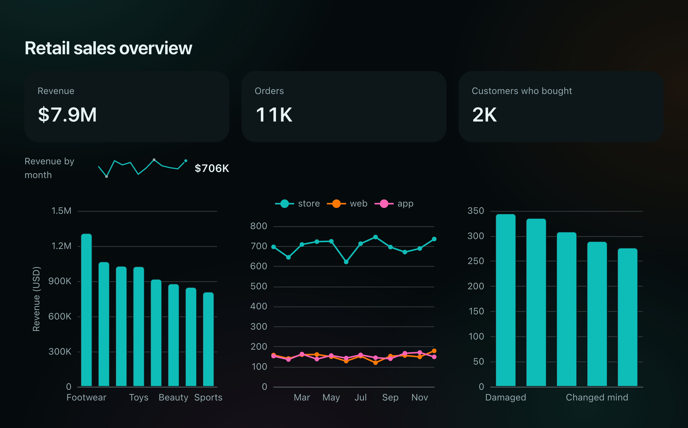 **Close up**: a 4× capture, numbers in tabular figures and chart lines drawn for the screen's own density. |

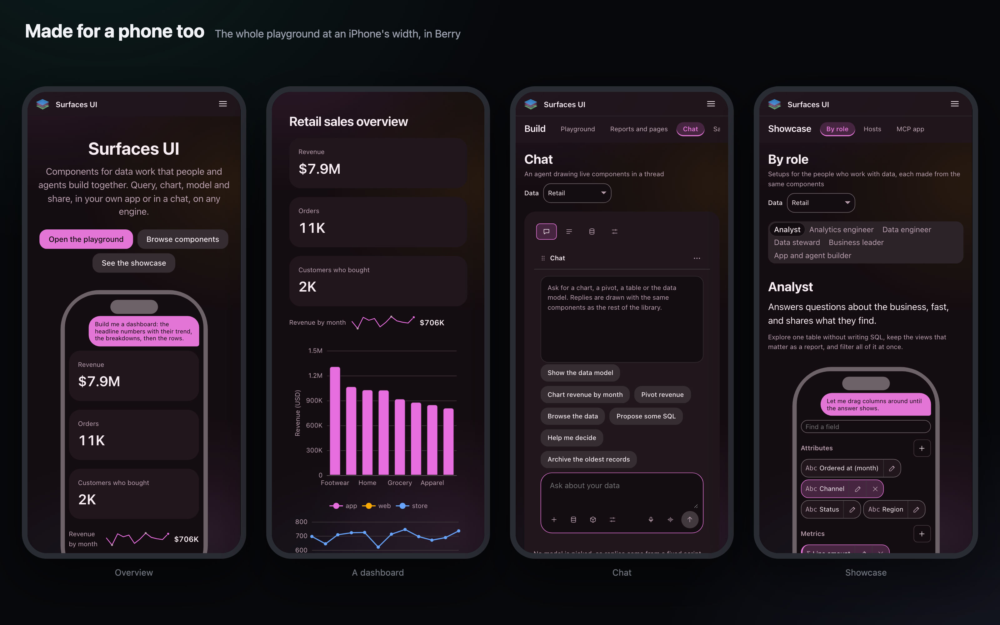

Every area of the playground works at phone width, and the browser tests fail if any page scrolls sideways at that size.

### Every component, every theme

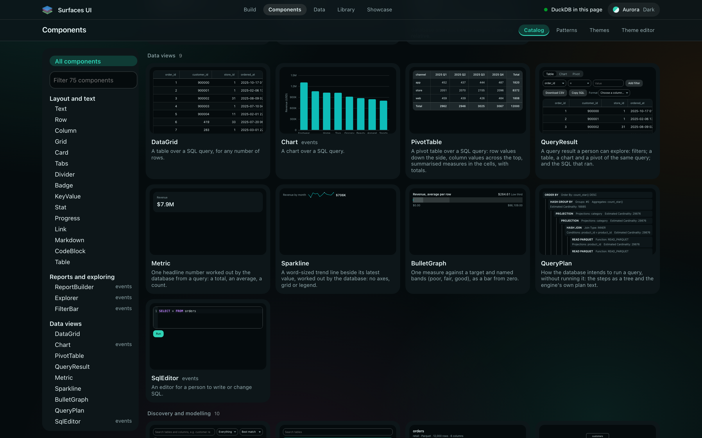

**Catalog**: every component at a glance, each drawn live from its example. Open one for its preview, its props as a form, its code as React, A2UI or json-render, and the events it sends.

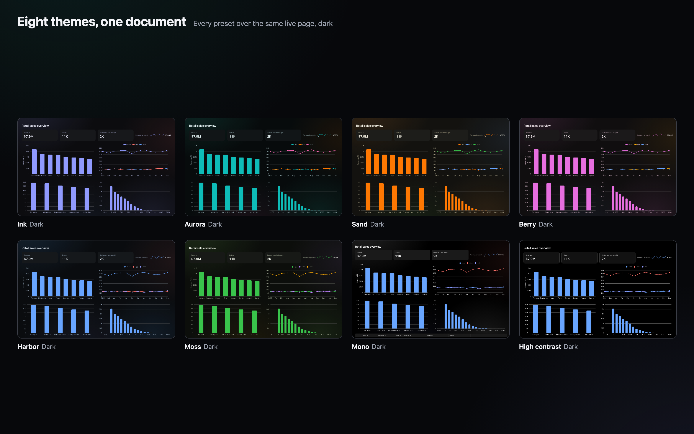

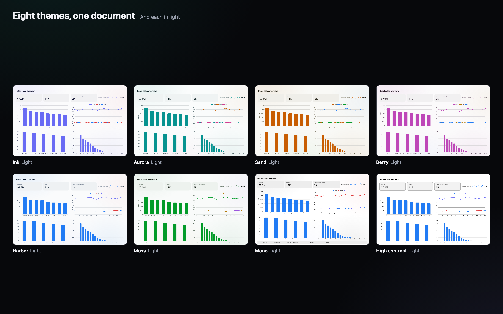

**Themes**: eight presets, each in light and dark: Ink (the default), Aurora, Sand, Berry, Harbor, Moss, Mono and High contrast. One theme document drives every colour. Chart series come from thirteen tested hues, ordered so neighbours stay apart under colour blindness, and every preset is tested for contrast. High contrast, or the person's own *increase contrast* setting in any theme, draws stronger edges and labels and turns glass solid.

### Setups by role

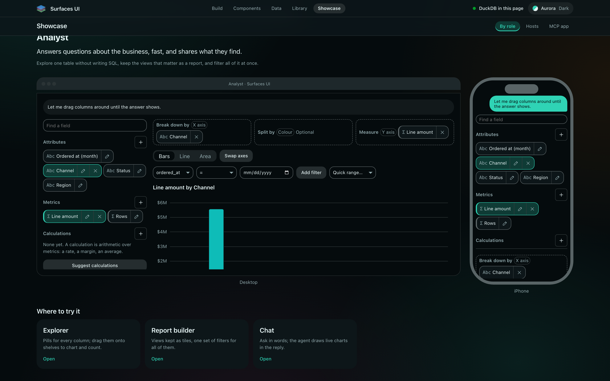

Setups for an analyst, an analytics engineer, a data engineer, a data steward, a business leader and an app builder, each made from the same components and live on a desktop and a phone.

## Try it in five minutes

You need Node 22 or later and pnpm 10 (`corepack enable` picks up the version this repo pins).

```bash
git clone https://github.com/Josh-Schoen/surfaces-ui.git
cd surfaces-ui
pnpm install
pnpm build
```

```bash
pnpm dev     # the playground, at http://localhost:5210
```

Open the playground and pick a dataset in the sidebar. With no server running, it loads DuckDB into the page with six synthetic industry datasets (retail, healthcare, fraud, telco, transportation and manufacturing), so everything above works offline.

To use the reference server as well, start it in a second terminal:

```bash
pnpm serve   # the data server, at http://localhost:5220
```

The sidebar then shows **Dev server**, and pipelines, saved results and the server's agent are switched on. To put a real model behind Chat, Pages and the composer, set `ANTHROPIC_API_KEY` (or `OPENAI_API_KEY`, or a local model through Ollama) before `pnpm serve`. Keys stay on the server and never reach the page.

The [getting started guide](docs/getting-started.md) walks through each area and then shows how to use the components in your own app.

## Use it in your project

```bash
npx create-surfaces my-app   # a dashboard, a chat that draws live components, and a data server with sample data
```

> The packages are not on npm yet. From a checkout, run `pnpm build` and then `node packages/create-surfaces/dist/cli.js my-app --from-repo .`, which packs the packages into the new app.

```tsx
import { Chart, DataSourceProvider, ThemeProvider } from "@surfaces-ui/components";
import { memoryDataSource } from "@surfaces-ui/data";
import "@surfaces-ui/components/styles.css";

const data = memoryDataSource({ tables: { sales: [{ region: "Europe", amount: 10 }, { region: "Americas", amount: 7 }] } });

<ThemeProvider>
  <DataSourceProvider dataSource={data}>
    <Chart sourceId="memory" sql="SELECT * FROM sales" type="bar" x="region" y={[{ column: "amount", aggregate: "sum" }]} />
  </DataSourceProvider>
</ThemeProvider>;
```

## How it fits together

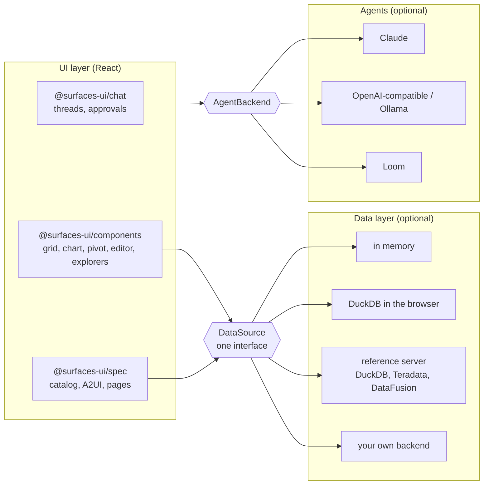

The UI depends on one interface, `DataSource`, and never imports an engine, driver or client. Bring your own backend by implementing that interface, with no data-layer package installed. Everything that crosses a process boundary is defined in [`proto/`](proto/surfaces/v1).

| Engine | Status |
|---|---|
| DuckDB (Parquet, CSV, JSON, Delta, Iceberg, attached Postgres) | Main engine; includes time travel, kept results and pipelines |
| Teradata | Read-only; run live against Teradata 20.00 through a driver connection |
| Apache DataFusion | Read-only, over ROAPI's HTTP endpoint |
| DuckDB-wasm | In the browser, with no server |

**Delivery:** a plain React import, A2UI surfaces in chat, and MCP Apps (`registerSurfacesApps`, or `npx surfaces-mcp install`). A [Claude Code plugin](plugins/surfaces-analytics) adds skills for chart standards, dashboard design, human-in-the-loop work, data cleaning and personal data.

## Status

This is early, pre-release software. What is built, and what has and has not been run against real systems, is listed under "Status" in [AGENTS.md](AGENTS.md). In brief, these have not been run yet:

- reading from real S3, GCS or Azure storage
- the Teradata Query Service transport
- Spark pipelines
- standalone app builds
- MCP in a desktop host

## Work on it

```bash
pnpm test               # Vitest, next to the code
pnpm typecheck
pnpm check:boundaries   # the UI must not import the data layer
pnpm docs:gen           # regenerates docs/catalog and docs/recipes
```

Read [AGENTS.md](AGENTS.md) before changing anything; it holds the rules (contracts first, SQL never in the browser, tokens only, accessibility to WCAG 2.2 AA). [docs/plan.md](docs/plan.md) has the architecture, and [docs/accessibility.md](docs/accessibility.md) maps each WCAG criterion to how it is met. Releases use Changesets (`pnpm changeset`).

## License

[Apache License 2.0](LICENSE). Copyright 2026 Josh Schoen; see [NOTICE](NOTICE).
