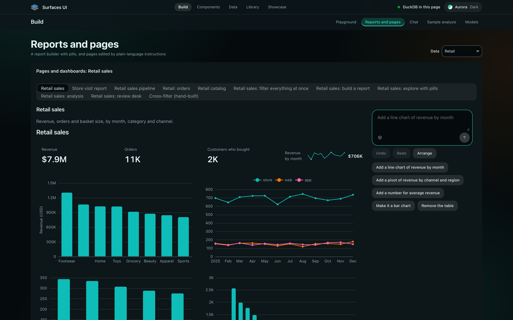
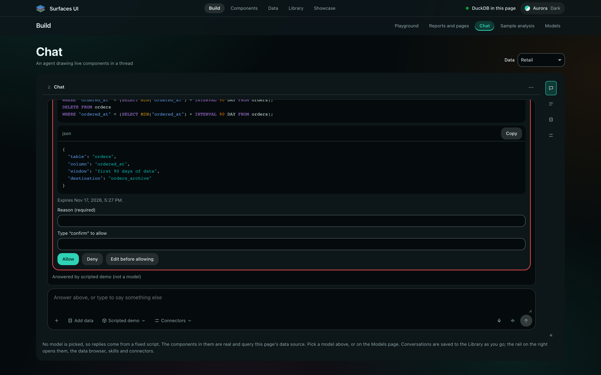
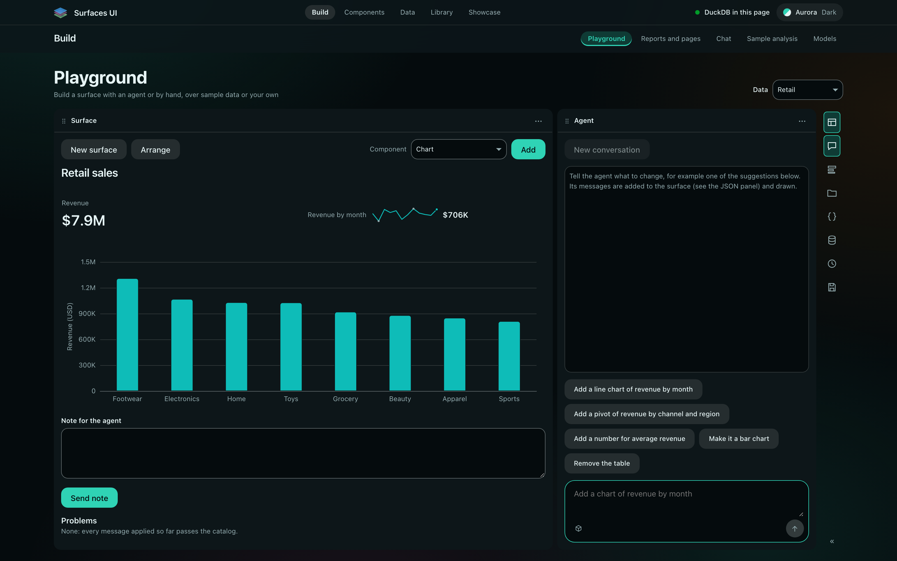
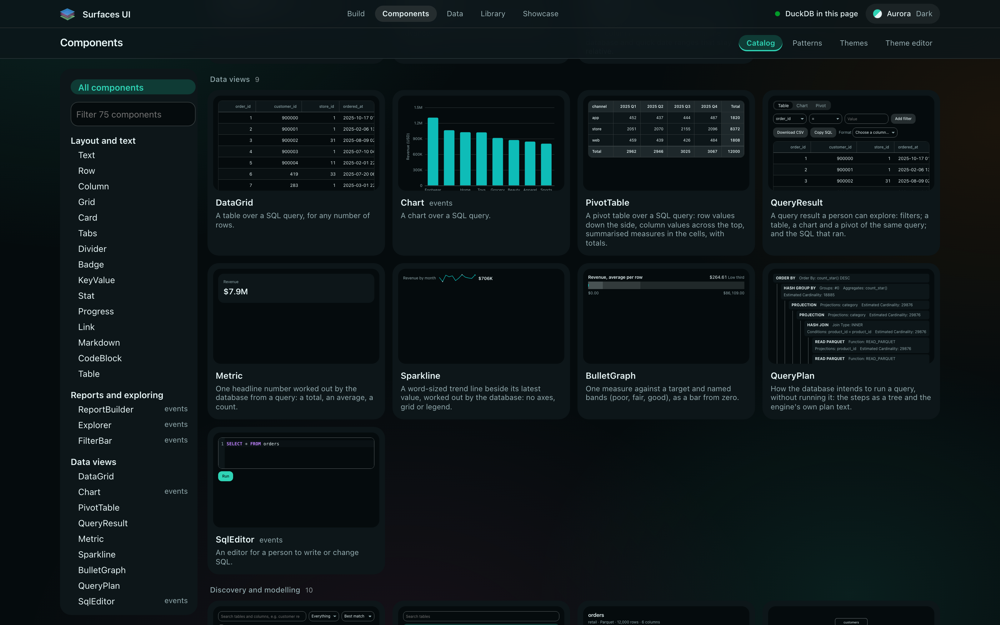
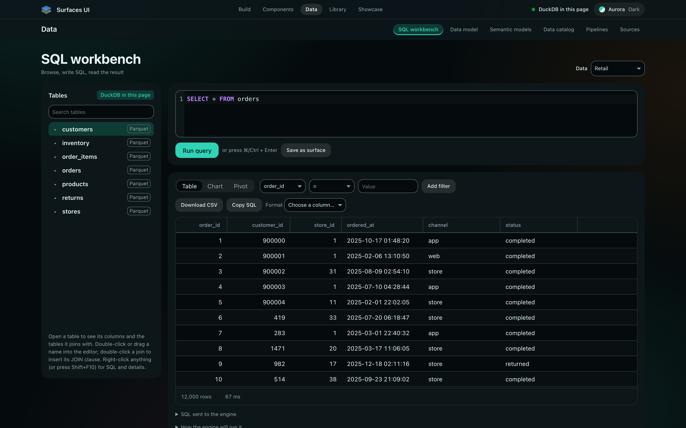
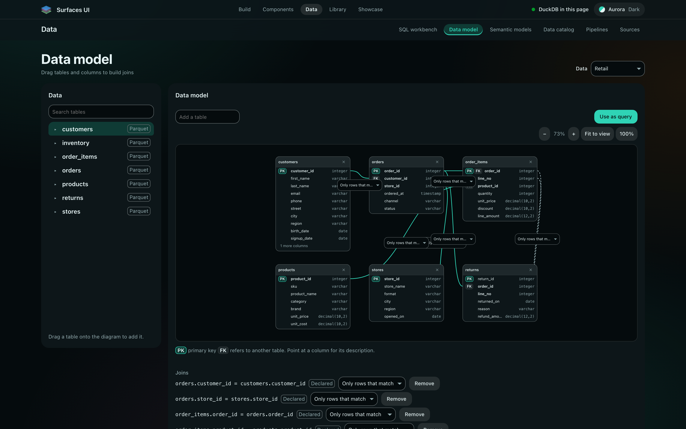
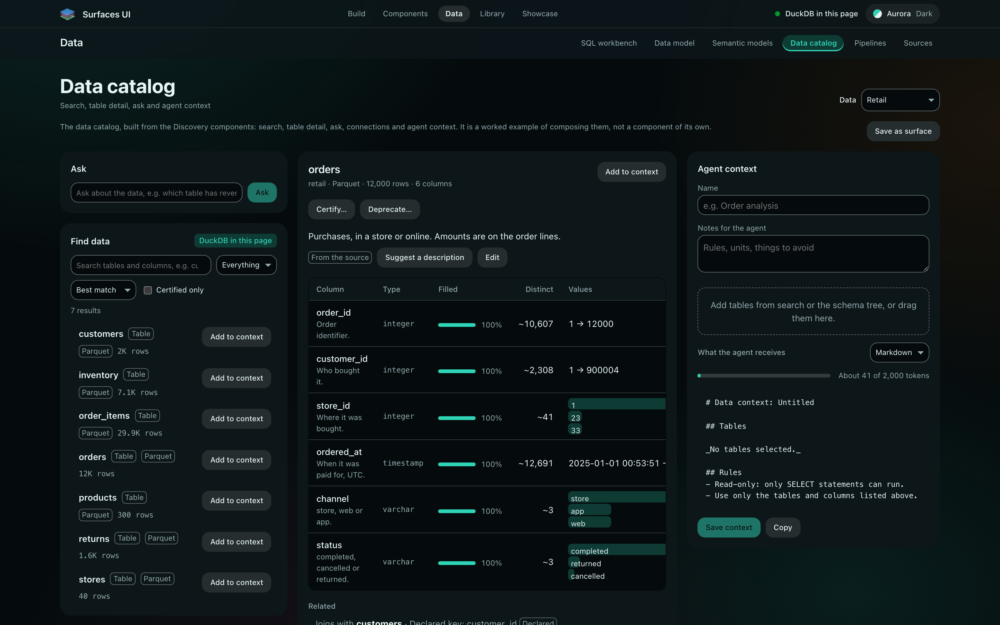
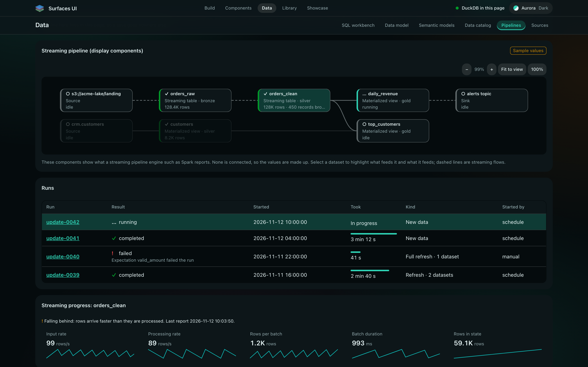
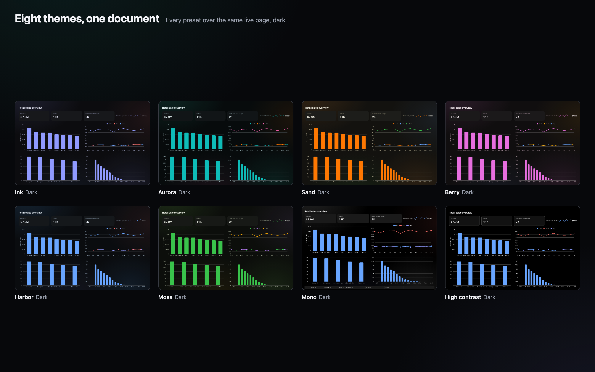

# Getting started

Surfaces UI is a set of React components for data and analytics: tables that stay fast at any size, charts, pivots, SQL editing, schema and catalog browsing, data modelling, chat, and pages an agent can build. It works in your app, a chat reply, a side panel or an MCP frame.

This guide is for people adding it to their own project. If you are an agent, read [agent-integration.md](agent-integration.md) and the [agent prompt](catalog/agent-prompt.md).

## See it running first

Running the playground in this repo is the quickest way to learn what the components do. It takes about five minutes and needs no server, keys or data of your own.

1. **Install and build.** You need Node 22 or later and pnpm 10 (`corepack enable` picks up the pinned version).

   ```bash
   git clone https://github.com/teradata-labs/surfaces-ui.git
   cd surfaces-ui
   pnpm install
   pnpm build
   ```

2. **Start the playground.**

   ```bash
   pnpm dev   # http://localhost:5210
   ```

   With no server running, the playground loads DuckDB into the page. The sidebar badge then reads **DuckDB in this page**.

3. **Optional: start the data server** in a second terminal. Pipelines, kept results and the server's agent need it.

   ```bash
   pnpm serve   # http://localhost:5220
   ```

   The badge changes to **Dev server**. To put a real model behind the agents, set `ANTHROPIC_API_KEY` (or `OPENAI_API_KEY`, or `SURFACES_LOCAL_MODEL_URL` and `SURFACES_LOCAL_MODEL` for a local model) before starting the server. You can also put the key in a git-ignored `.env.local` beside `surfaces.config.ts`. There is no field for a key in the page.

4. **Pick a dataset** in the sidebar under **Data**. There are six synthetic industry models: retail, healthcare, fraud, telco, transportation and manufacturing. Each has keys, descriptions and some deliberately planted data problems. Every area uses the dataset you pick.

### A tour

**Pages** (Build): example dashboards that change when you type an instruction. Try "Add a line chart of revenue by month", then Undo. Until you pick a model, the agent is a scripted demo and says so.



**Chat** (Build): a thread whose replies are live components. "Chart revenue by month" draws a headline number, a sparkline and a line chart that all query the dataset. "Archive the oldest records" shows an approval. The card shows the exact SQL, asks for a reason and a typed confirmation, and lets you edit the SQL before allowing it.



**Playground** (Build, and where the app opens): builds a surface piece by piece. Add any catalog component, or give the agent on the right an instruction. Its parts are panels you arrange: the surface and the agent show to begin with, and a rail on the right shows and hides the surface's components (edit, re-point or remove one at a time), its JSON and A2UI messages, its data model, and a History that can restore the surface to before any change. Drag a panel by its heading to move it, or use its Move menu. "New surface" starts again.



**Catalog** (Components): all 56 components, each with a live preview, a props form generated from its schema, and the events it sends to an agent. Edit a prop and the preview redraws. The same JSON is what an agent would send.



**SQL workbench** (Data): an object browser, an editor and a result you can see as a table, chart or pivot. Right-click a table (or press Shift+F10) for generated SQL. "SQL sent to the engine" shows exactly what ran.



**Data model** (Data): tables as cards with primary and foreign keys. Drag a column onto another to join them, then press **Use as query**. Joins the source declares are labelled "Declared", and guesses stay "Inferred" until you confirm them.



**Data catalog** (Data): search tables and columns, open a table's profile, certify or deprecate it, and build the context pack an agent receives. The pack shows the exact text and its token count.



**Pipelines** (Data, needs the server): datasets built from one another with quality rules, and checks over each built table (its key never repeats, its references are found, its codes are known). **Run** builds them in DuckDB, where they can be queried like any other table. A full refresh asks you to confirm it first. The same runs work with no browser: `npx surfaces-pipelines run retail-sales` prints each dataset and check and exits 1 when one fails.

A dbt project shows up here too. Point the server at its target directory (`SURFACES_DBT_TARGET`, and `SURFACES_DBT_DATABASE` for a dbt-duckdb file) and the project's models, tests and dbt's own runs appear as a pipeline, read from dbt's artifacts; its semantic models become starter semantic models. dbt still builds it: with `SURFACES_DBT_PROJECT` set, Run asks dbt to build, and without it the project is read only.



**Themes** and **Theme editor** (Components): every preset over the same data, and an editor for accent, radius, density and chart colours. A contrast check runs live as you edit.



When you have seen enough, the rest of this guide shows how to put the same components in your own app.

## The fastest start

```bash
npx create-surfaces my-app
cd my-app && npm install
npm run serve   # the data server, with six sample datasets; set ANTHROPIC_API_KEY first for the chat
npm run dev     # the app: a dashboard, and a chat that draws live components
```

The app it writes is small and yours to change: `src/dashboard.ts` is a page as plain JSON, `src/App.tsx` wires the providers, and `surfaces.config.ts` sets up the server and the agent. Before the packages are on npm, run it from a checkout of this repo after `pnpm build`: `node packages/create-surfaces/dist/cli.js my-app --from-repo .` packs the packages into `my-app/vendor` and points the app at them.

[Recipes](recipes/README.md) show common jobs as code that is tested in CI.

## What you install

You choose the layers you need. The UI layer never depends on the data layer, so you can bring your own backend.

| You want | Install |
|---|---|
| Components (grid, chart, pivot, editor, explorers, forms) | `@surfaces-ui/components` `@surfaces-ui/data` |
| Pages and views an agent describes in JSON | add `@surfaces-ui/spec` |
| A chat thread with an agent | add `@surfaces-ui/chat` `@surfaces-ui/agent` |
| Shared state, undo, URL sync | add `@surfaces-ui/state` |
| Developer tools for what an agent draws | add `@surfaces-ui/devtools` |
| Our reference backend (DuckDB, Teradata, DataFusion over Connect) | add `@surfaces-ui/client-connect` in the app, and run `@surfaces-ui/dev-server` |
| SQL in the browser with no server | add `@surfaces-ui/datasource-duckdb-wasm` and `@duckdb/duckdb-wasm` |
| An agent backend | `@surfaces-ui/agent-anthropic` (Claude), `@surfaces-ui/agent-openai` (OpenAI-compatible servers), `@surfaces-ui/agent-loom`, or `toolCallingAgent` from `@surfaces-ui/agent` over any model |

React 19 is a peer dependency.

```bash
npm install @surfaces-ui/components @surfaces-ui/data react react-dom
```

> The packages are not published to npm yet. Until they are, `create-surfaces --from-repo` (above) packs them for you. To do it by hand: run `pnpm build`, then `pnpm pack` in each package, point your `package.json` at the files (`"@surfaces-ui/components": "file:./vendor/surfaces-components-0.0.0.tgz"`), and list every packed package under `overrides` the same way, because they depend on one another by version.

## The three providers

```tsx
import { DataSourceProvider, ThemeProvider } from "@surfaces-ui/components";
import "@surfaces-ui/components/styles.css";

<ThemeProvider>                           {/* sets the --sf-* variables; remembers the person's choice */}
  <DataSourceProvider dataSource={data}>  {/* where queries go */}
    <App />
  </DataSourceProvider>
</ThemeProvider>
```

`DiscoveryProvider` (search, table detail, agent context), `PipelinesProvider`, `FormsProvider` and `SemanticsProvider` (semantic models) are optional. A component that needs one says so when it is missing.

To change how it looks, start with a theme; [styling.md](styling.md) covers scoped themes, `--sf-*` variables, `className`, and `styles.layer.css` for apps whose own CSS should win (Tailwind included).

With TypeScript and Vite, add `/// <reference types="vite/client" />` (or `"types": ["vite/client"]`) so the CSS import type-checks.

## Your data

Every component talks to one interface, `DataSource` from `@surfaces-ui/data`. Components send a `ViewQuery` (your SQL plus sorts, filters, paging, grouping and aggregates), and the backend runs it. Rows are never sorted or filtered in the browser.

Pick one:

```ts
// 1. In memory, for tests, demos and small data.
import { memoryDataSource } from "@surfaces-ui/data";
const data = memoryDataSource({ tables: { sales: rows } });

// 1b. A page's own rows, as JSON writes them: { tables: { bills: [{ due: "2026-01-05", amount: 80 }, ...] } }.
//     Missing keys become null and columns of ISO dates become dates, so charts group them by month.
import { pageDataSource } from "@surfaces-ui/data";
const data = pageDataSource(page.data);   // components use sourceId="page", sql="SELECT * FROM bills"

// 2. Our server (DuckDB, Teradata or DataFusion), over Connect.
import { connectDataSource } from "@surfaces-ui/client-connect";
const data = connectDataSource({ baseUrl: "https://your-server" });

// 3. DuckDB in the page (WebAssembly). Pass bundle URLs from your own build, never a CDN.
import { createDuckDbWasmDataSource, openBrowserDuckDb } from "@surfaces-ui/datasource-duckdb-wasm";

// 4. Your own backend: implement DataSource (execute, count, listTables, describeTable, explain, ...).
```

To run the reference server, put a `surfaces.config.ts` beside your app and run `npx surfaces-dev`. With no config, it serves six sample datasets: retail, healthcare, fraud, telco, transportation and manufacturing. Credentials are named, never written in config: `secret: "LAKE"` reads `LAKE_KEY_ID` and `LAKE_SECRET` from the server's environment.

## A first view

```tsx
import { Chart, DataGrid, QueryResult } from "@surfaces-ui/components";

<DataGrid sourceId="lake" sql="SELECT * FROM orders" height={400} />
<Chart sourceId="lake" sql="SELECT * FROM orders" type="bar" x="region" y={[{ column: "amount", aggregate: "sum" }]} />
<QueryResult sourceId="lake" sql="SELECT * FROM orders" />   {/* table, chart and pivot, with export */}
```

Each component's props, events and an example are in [docs/catalog/components](catalog/components). Components an app places itself rather than an agent (the chats, `PageStudio`, `ThemePicker`, `ConnectionBuilder` and others) have their own pages in [docs/components](components/README.md), with the parts a host supplies in code. The playground (`pnpm dev` in this repo) lets you edit the props and see the result live, under Components, App components included.

## Metrics defined once: semantic models

A semantic model names a query and the dimensions, measures and metrics on it, each with who defined it. Give `Explorer` or `ReportBuilder` a `model` instead of `sourceId` and `sql`, and its pills are the model's fields, so "Refund rate" means the same thing in every report.

```tsx
import { SemanticsProvider, Explorer, useSemanticModel } from "@surfaces-ui/components";
import { memorySemantics } from "@surfaces-ui/data";            // or connectSemantics({ baseUrl }) from @surfaces-ui/client-connect

function Sales() {
  const { model, promote } = useSemanticModel("sales_lines");   // reads from the SemanticsProvider above it
  return model ? <Explorer model={model} onPromote={promote} /> : null;
}

<SemanticsProvider semantics={memorySemantics({ models: [salesLines] })}>
  <Sales />
</SemanticsProvider>
```

A model says what one row is (its grain) and which columns make a row unique, and the engine checks that key before a new model is kept, so sums never count a row twice. Its rows come from a written query, or from tables and joins drawn in the editor: the first table is where the rows come from, the others add detail, each join says which rows it keeps (every row of the first table, by default) and is marked when it could repeat rows, which you can have the engine count. To make one, start with your agent: it reads the tables and proposes the joins, grain, key and fields, and you change any of it before saving. Without an agent, `SemanticModelEditor` given a model of version 0 creates one, and "Draft fields from the columns" fills it from the columns' names and types. A pill a person makes in a report is added to the model from its menu ("Add to the model", key M); every save is a new version, and a save made against an older version is refused. `SemanticModelEditor` shows a draft with what was added, changed and removed before anything is kept. The dev server keeps one JSON file per model in `<storeDir>/semantic/` and checks every save against the data first; the six sample datasets each start with one.

When a pipeline already builds the rows, build the model on that dataset instead: with a `PipelinesProvider` above it, a new model in `SemanticModelEditor` offers "Start from a pipeline dataset", which takes the dataset's grain, key and columns (`semanticModelFromDataset` does the same in code). The pipeline checks that key after every build, and `ModelLineage` says when the dataset was last built, how its checks went and what it reads, in the editor and as one line over every `Explorer` and `ReportBuilder` on the model.

## Pages an agent (or you) describe

A page is plain JSON: a flat list of catalog components with a `root`. Draw it with `SurfaceView`:

```tsx
import { analyticsCatalog, pageSurface } from "@surfaces-ui/spec";
import { SurfaceView, analyticsRenderers } from "@surfaces-ui/spec/react";

<SurfaceView
  surface={pageSurface(page)}
  catalog={analyticsCatalog}
  renderers={analyticsRenderers}
  onAction={(action) => /* a control was used: action.name, action.context */}
  onDataChange={(data) => /* what the person typed */}
  onControlsChange={(id, controls) => /* sorts, filters, columns a person changed, as props */}
/>
```

Every component is checked against the catalog before it is drawn. Anything unknown or malformed is shown as a notice, never rendered.

A person can arrange a page by hand, if you offer it: `useArrange` from `@surfaces-ui/spec/react` frames each component so it can be dragged (or moved by keyboard) before, after or beside another, and resized, and hands you each change as the same A2UI an agent would send, to take in with `editsFromMessages` and `editPage` as one undo step. It is optional: with it off the page draws the same. `PageStudio` takes `arrange` to do this beside its instruction box. See the recipe [A dashboard a person can arrange](recipes/arrange-dashboard.md).

The same page can be written as JSX. Each catalog component is an element taking exactly its catalog props, and the outermost element draws the whole tree through the same checks:

```tsx
import { analyticsMarkup as Ui } from "@surfaces-ui/spec/react";

<Ui.Grid columns={2}>
  <Ui.Metric sourceId="lake" sql="SELECT * FROM orders" column="amount" aggregate="sum" label="Revenue" format="currency" />
  <Ui.Stat label="Orders" value={{ path: "/orders" }} delta="+5.4% vs last quarter" tone="positive" />
</Ui.Grid>
```

`Ui.` is for a page that should behave like an agent's surface: its props checked against the catalog, values bound to the page's data with `{ "@path": … }`, and its events sent back. The outer element reads the whole tree and draws it as one surface, so `Ui.Metric` is not the `Metric` component itself. The renderers load the first time a page draws, so using a few elements does not load every chart and editor up front. In app code that needs none of that, import the components themselves, which a bundler keeps only as you use them:

```tsx
import { Chart, Metric } from "@surfaces-ui/components";
```

`toMarkup(components)` writes a page as that JSX, `toJsonRender(components)` writes it as a json-render spec, and `fromJsonRender(spec)` reads one back. Every page in [the component reference](catalog/components) shows its example all three ways.

## Chat with your agent

```tsx
import { Chat } from "@surfaces-ui/chat";

<Chat agent={agent} user={{ id: "u1", name: "Ada" }} storage={browserStorage()} starters={["Show revenue by region"]} />
```

`user` is who decides approvals. `storage` (from `@surfaces-ui/state`) keeps the thread across reloads; leave it out to keep it in memory.

For people who work with data, `AnalyticsChat` adds what they reach for, each only when you pass it: saved conversations they can search, filter, sort and group (`sessions`), files and tables to attach (`attachFiles`, `browse`), the agent, model, skills and connectors (`agents`, from `DescribeAgents`; `providers` groups the Model menu by where models run), and voice (`speech`, with `speechConsent` to ask on first use). Short lists are menus in the composer; "View all…" opens a panel on the rail to the right.

```tsx
import { AnalyticsChat, librarySessions } from "@surfaces-ui/chat";

const agent = connectAgent({ baseUrl }); // send and describeAgents
const { agents } = await agent.describeAgents();
<AnalyticsChat agent={agent} agents={agents} sessions={librarySessions(library)} browse={{ sourceId: "lake" }} />
```

The recipe [A chat for analytics users](recipes/analytics-chat.md) has the whole page.

`agent` is any `AgentBackend`:

```ts
interface AgentBackend {
  send(request: SendRequest, options?: { signal?: AbortSignal }): AsyncIterable<SendResponse>;
}
```

- **On your server, over Connect:** give `surfaces.config.ts` an `agent` and use `connectAgent({ baseUrl })` from `@surfaces-ui/client-connect` in the browser. Model keys stay on the server.
- **Claude:** `anthropicAgent({ client: new Anthropic(), system })` from `@surfaces-ui/agent-anthropic`, on a server. It defaults to `claude-sonnet-5-5` and turns on server-side refusal fallbacks (`fallbacks: false` to turn them off).
- **OpenAI-compatible servers** (OpenAI, Ollama, vLLM, LM Studio): `openAiCompatibleAgent({ baseUrl, model })` from `@surfaces-ui/agent-openai`.
- **Loom:** `loomAgent({ baseUrl, token })` from `@surfaces-ui/agent-loom`.
- **Any other model that calls tools:** `toolCallingAgent({ system, complete })` from `@surfaces-ui/agent`. You write `complete`, which maps the adapter's neutral messages and tools onto your provider's API. The model draws by calling `render_surface`.
- **Your own service:** implement `send` against the `AgentService` contract in `proto/surfaces/v1/agent.proto`.

What the agent receives and what it may send back is described in [agent-integration.md](agent-integration.md).

## Theming

```tsx
import { ThemePicker } from "@surfaces-ui/components";
<ThemePicker />   // presets, accent, radius, font, density, light/dark
```

Everything is drawn from `--sf-*` CSS variables, generated from one theme document (`@surfaces-ui/tokens`). That includes the chart colours (`--sf-series-*`) and code highlighting (`--sf-code-keyword`, `-string`, `-number`, `-literal`, `-comment`, `-property`, `-function`, `-type`, `-punctuation`). To change code colours, put them in the theme:

```ts
parseTheme({ ...theme, code: { dark: { keyword: "#C792EA" } } }, defaultTheme);
```

Each colour is adjusted until it reads at 4.5:1 on the theme's background and surfaces, so a theme cannot make code unreadable. To theme one region, use `<ThemeProvider scope="scoped">`. To export a theme as CSS, call `themeCss(theme)`. An app with its own look starts from the preset closest to it (`presetByName("Sand")`) or passes its own theme document.

## Words and numbers

Numbers and dates are written in `en-US` and the words on screen are English until you say otherwise. Wrap the page once:

```tsx
import { SurfacesText } from "@surfaces-ui/components";

<SurfacesText locale="de-DE" labels={{ "grid.copyValue": "Copy" }}>
  <QueryResult sourceId="main" sql="SELECT * FROM sales" />
</SurfacesText>
```

- `locale` sets how every number and date is written (1.234,5 in German). `labels` replaces any of the words, by name; the rest stay English. A wrong name is a type error.
- The names and their English text are in `defaultLabels` (`grid.*`, `result.*`, `chart.*`, `pivot.*`, `filter.*`, `form.*`, `plan.*`, `receipt.*`, `report.*`, `cell.null`, `cell.true`, `cell.false`). `{count}`-style markers are filled in when the words are shown.
- An app for people who do not write SQL can use plain words: `"result.sqlSent": "The question as the computer asked it"`, `"cell.null": "–"`.
- Both are page-wide: one locale and one set of words per page. Without React, call `setLocale("de-DE")` and `setLabels({...})` before the components render; `resetLabels()` goes back to English, and `label(name, values)` and `numberFormat(options)` give the same text and number formats to your own code.
- The SQL editor, catalog, pipelines and model diagrams keep their English words: they are for people who work with SQL.

## Dev tools

Wrap the app once and everything the library does inside it is recorded and shown: every message an agent sent (as it arrived, as it was read, and what the catalog said about it), each component drawn, problems, state, the events sent back, agent turns, and calls to your backends with their SQL and timings.

```tsx
import { SurfacesDevTools } from "@surfaces-ui/devtools";

<SurfacesDevTools>
  <App />
</SurfacesDevTools>
```

- A small button at the corner of the page, and Ctrl+Shift+D (⌘⇧D on a Mac), open a panel docked to the bottom or the side. It resizes, and can move to a window of its own.
- **Time travel.** The scrubber picks a step; the Surface pane draws each surface as it stood then, read-only. The data is queried again, live, so numbers are today's; nothing pressed there reaches the agent.
- **Find a component, and what it did.** Pick one in the Components pane, or press "Pick a component on the page" and click it there. It is outlined where it is drawn, and the timeline, messages, events and service calls are narrowed to that component: the messages that sent it, its queries with their SQL, its problems. The "Only …" chip clears it. **Likely cause** lists what the recording says is wrong with it, most likely first (the message was refused, the catalog did not accept a prop, nothing draws it, a binding points at nothing, its query failed or came back empty), each with a Show button. It is worked out by fixed rules, not a model, so it can only say what was recorded.
- **No wiring.** `DataSourceProvider`, `DiscoveryProvider`, `PipelinesProvider`, `SemanticsProvider`, `SurfaceView`, `useSurfaces`, `useChat` and `Chat` notice the tools above them and record themselves. A backend you call outside those is wrapped by hand: `traceDataSource(dataSource, recorder)`, `traceAgent(agent, recorder)` or `traceService("Orders", service, recorder)` from `@surfaces-ui/trace`, with `useRecorder()` from `@surfaces-ui/trace/react` for the recorder.
- **On in development, absent in production.** `enabled` defaults to `process.env.NODE_ENV !== "production"`. Off, the component renders its children and nothing else, records nothing, and loads none of the panel. To offer the tools to some people in production, pass your own rule: `enabled={user.isDeveloper}`. No URL or stored value turns them on.
- **A trace never holds row values or credentials.** It holds names, SQL text, counts, timings, errors, notices, and the filter values a person chose. It stays in the page: at most 2,000 events (`limit`), in memory.
- `performanceTracks` also shows spans as custom tracks in the Performance panel of Chrome's developer tools.

Without the widget, `createRecorder()` with `<TraceProvider recorder={recorder}>` records the same events for your own use (`recorder.get()`, `recorder.subscribe`), and `DevToolsPanel` from `@surfaces-ui/devtools/panel` shows any feed of them.

## Delivering somewhere else

- **MCP Apps** (Claude and other MCP hosts): `registerSurfacesApps(server, { dataSource, appHtml })` from `@surfaces-ui/mcp`, or `npx surfaces-mcp install --dir <repo>`.
- **Static site**: use the DuckDB-wasm data source; nothing needs a server.
- **A plain HTML page with no build step** (an app's web view): `@surfaces-ui/page` is one script and one stylesheet; `surfaces.mountPage(element, page, { theme })` draws a page over its own rows. ECharts is left out, so the page loads its own copy. See [packages/page](../packages/page/README.md).

## Size

Every catalog component has a renderer, ECharts and CodeMirror among them: about 430 KB gzipped. `Chat` and `PageStudio` load them on first use (`lazyAnalyticsRenderers` from `@surfaces-ui/spec/react`), so a page with a chat starts at about 160 KB gzipped and fetches the rest when the first surface is drawn. Pass `lazyAnalyticsRenderers` to your own `SurfaceView` to do the same, and call `preloadRenderers()` when you know a surface is coming. An app that imports only a few components directly gets only those.

## Rules worth knowing

- Queries are read-only: a single `SELECT` or `WITH`. Writes go through pipelines and forms the server defines; a pipeline an agent proposes is saved only when a person approves it in a `DatasetReview`, and only on a server with `savedPipelines: true`.
- Data values are not sent to a model or indexed unless a source is listed in `allowSampleValues`.
- SQL an agent proposes is shown and offered, never run on its own.
- Accessibility target: WCAG 2.2 AA. See [accessibility.md](accessibility.md) for the keys.
